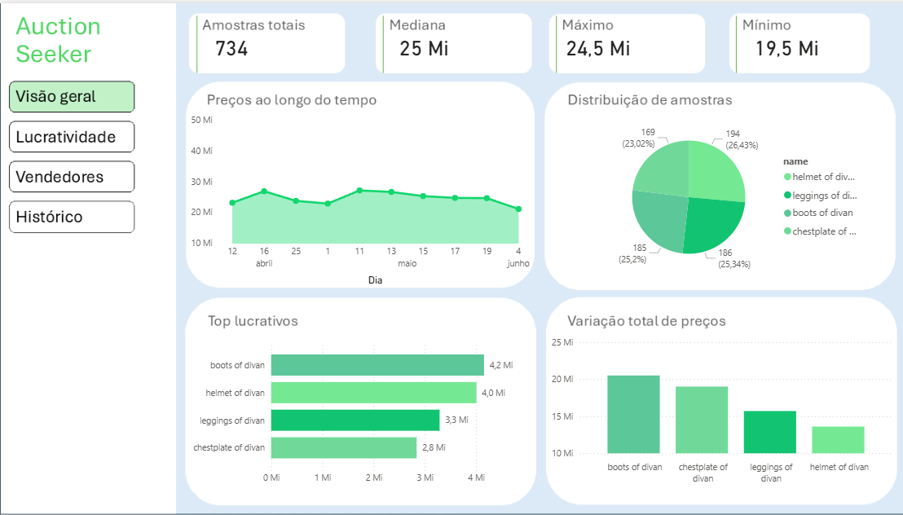
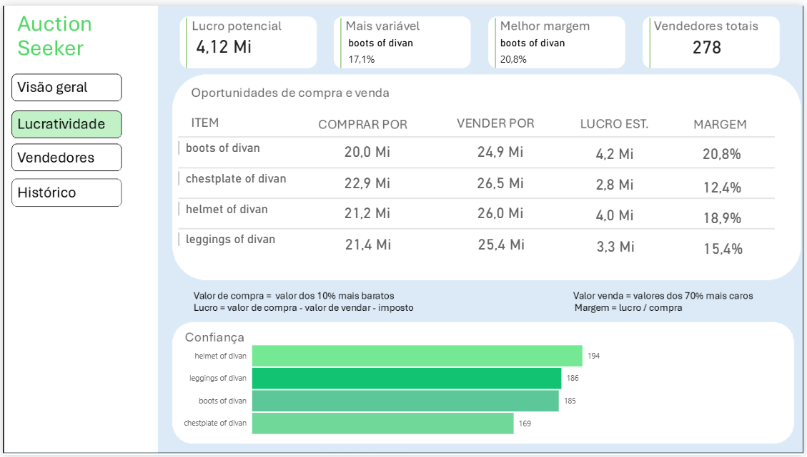
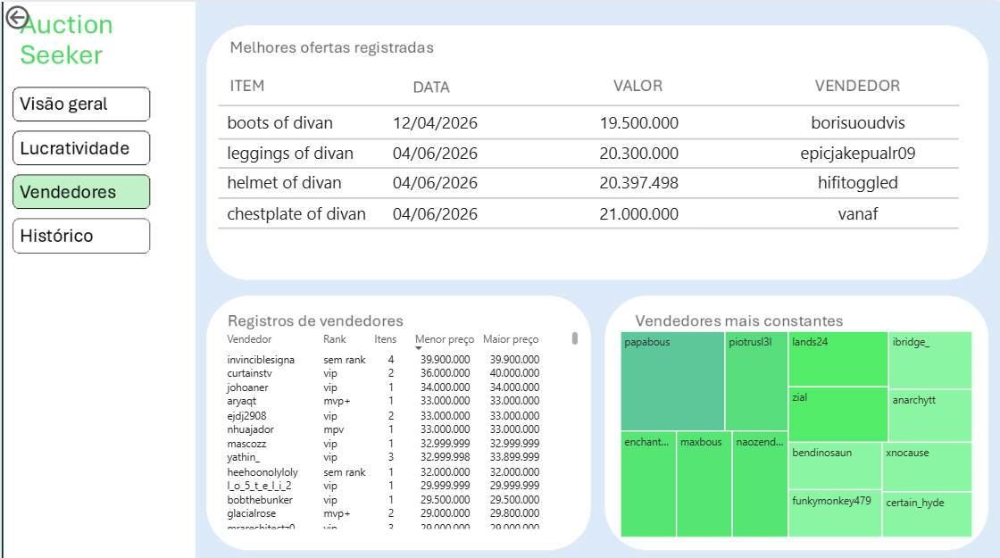
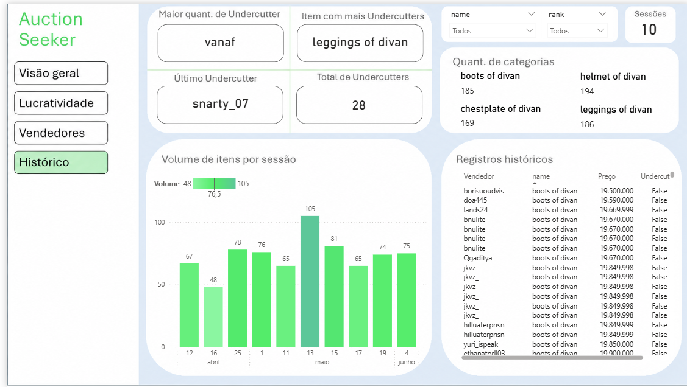

# Resultados

Este documento reúne os resultados visuais do projeto: as páginas do dashboard "Auction Seeker" no Power BI e as métricas do modelo de visão computacional.

---

## Dashboard — Auction Seeker (Power BI)

### Visão Geral

_Panorama geral do volume de itens analisados e principais métricas do sistema._



### Lucratividade

_Margens de lucro, itens mais lucrativos e variação de preços (ex: coeficiente de variação para itens de divan gear)._



### Vendedores

_Ranking de sellers, melhores ofertas registradas por item, consistência de vendedores (treemap) e margens por seller._



### Histórico

_Evolução de preços ao longo do tempo e detecção de undercutting (medidas "Maior quant. de Undercutter" e "Último Undercutter")._



---

## Vídeo demonstrativo

Navegação completa pelas quatro páginas do dashboard, incluindo interatividade dos slicers:

🎥 [Assistir no YouTube](https://youtu.be/OiVu1KLpnls)

---

## Captura e visão computacional (I_A_H)

### Detecção em tempo real


### Métricas do modelo

| Métrica | Valor |
|---|---|
| Modelo base | `yolo11s.pt` |
| Dataset | ~113 imagens |
| Split | 80% treino / 20% validação |
| Épocas | 15 |
| mAP50 | 0.995 |

---

## Exemplo de dado tratado

Exemplo (sanitizado) de um documento antes e depois de passar pelo ETL, ilustrando a transformação bronze → silver.

**Antes (MongoDB, bronze — recém-capturado):**

```json
{
  "scan_timestamp": "20260416_180812",
  "raw_text": "...",
  "sanitized_text": "...",
  "parsed": {
    "name": "dimensional leggings of divan",
    "tier": "legendary",
    "seller": "[mvp+] tuisteduanesk",
    "price": 39900000,
    "class": "Equipment"
  }
}
```

**Depois (MongoDB, pós-ETL — etiquetado):**

```json
{
  "_id": "ObjectId('69e178260433625a75d9d15b')",
  "scan_timestamp": "20260416_180812",
  "raw_text": "...",
  "sanitized_text": "...",
  "parsed": {
    "name": "dimensional leggings of divan",
    "tier": "legendary",
    "seller": "[mvp+] tuisteduanesk",
    "price": 39900000,
    "class": "Equipment"
  },
  "etl_error": null,
  "etl_status": "validated"
}
```